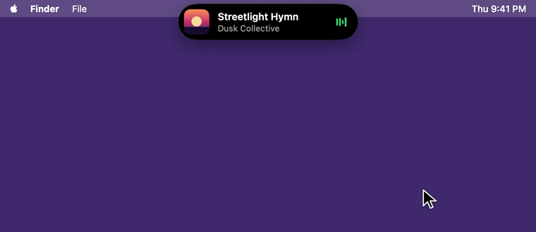

# Lyrics Island

**Synced Spotify lyrics in a Dynamic Island–style pill at the top of your Mac's screen.**

The current line follows the song in real time. Hover the pill and it expands into a karaoke-style lyrics panel with playback controls.



```bash
brew tap apin24/tap && brew trust --tap apin24/tap
brew install --cask apin24/tap/lyrics-island
```

## Features

- **Live, line-synced lyrics** for whatever the Spotify desktop app is playing
- **Karaoke panel on hover:** the active line lights up word by word, surrounded by the previous and next lines
- **Click any line to jump to it**, or click the progress bar to seek
- **Play/pause, previous and next** right from the island
- **Per-song timing fix:** nudge lyrics ±0.5s if they run early or late; it's remembered for that song
- **Manual lyrics search** when the automatic match fails
- **Stays out of the way:** hides when Spotify is closed or paused for 10s, never grows over your menu bar icons, optional hide-in-fullscreen
- **⌥⌘L** global shortcut to show/hide
- **Demo mode** to try it without Spotify
- Tiny native app: Swift + SwiftUI, no Electron, no account, no API key

## States

| | |
|---|---|
|  | **Song change:** artwork, title and artist for 2.5s |
|  | **Finding lyrics:** usually under a second, then cached |
|  | **Compact:** the line being sung right now |
|  | **Interlude:** instrumental breaks |
|  | **No lyrics found:** shrinks to a mini pill after 5s |
|  | **Paused:** disappears after 10s |

## Requirements

- macOS 14 Sonoma or later (Apple silicon or Intel)
- The **[Spotify desktop app](https://www.spotify.com/download/mac/)**. The web player and Safari "Add to Dock" web apps can't be read by other apps.

## Install

### Homebrew (recommended)

```bash
brew tap apin24/tap
brew trust --tap apin24/tap
brew install --cask apin24/tap/lyrics-island
```

Recent Homebrew versions only load casks from third-party taps you've trusted, hence `brew trust`. Update later with `brew upgrade --cask lyrics-island`.

### Download

Get `LyricsIsland-<version>.zip` from the [latest release](https://github.com/apin24/lyrics-island/releases/latest), unzip it and drag **LyricsIsland.app** into `/Applications`. It's a universal app for Apple silicon and Intel.

### Allow it to open (one time)

Lyrics Island isn't notarized by Apple yet (that needs a paid Apple Developer account), so macOS blocks the first launch:

1. Open the app. macOS says it can't verify the developer → click **Done**.
2. Go to **System Settings → Privacy & Security**, scroll down, click **Open Anyway** next to *"LyricsIsland" was blocked*, and confirm.

Or do it in one line in Terminal:

```bash
xattr -dr com.apple.quarantine /Applications/LyricsIsland.app
```

All the code is in this repo, so you can also build it yourself:

### Build from source

Needs the Xcode Command Line Tools (`xcode-select --install`). Full Xcode is **not** required.

```bash
git clone https://github.com/apin24/lyrics-island.git
cd lyrics-island
./scripts/build-app.sh
open build/LyricsIsland.app
```

To try it without Spotify:

```bash
open /Applications/LyricsIsland.app --args --demo
```

### First launch

When Lyrics Island first talks to Spotify, macOS asks:

> “Lyrics Island” wants access to control “Spotify”.

Click **OK**. If you clicked *Don't Allow*, open **System Settings → Privacy & Security → Automation → Lyrics Island** and turn on **Spotify**. The 💬 menu bar icon shows a warning with a shortcut there while access is missing.

> If you build it yourself, macOS may ask again after each rebuild (the build is ad-hoc signed). That's expected.

## Usage

| Action | Result |
|---|---|
| Hover the island (~0.3s) | Expands: karaoke lyrics, progress, controls |
| Click a lyric line | Seek to that line |
| Click the progress bar | Seek |
| **−** / **+** (bottom right) | Lyrics too early / too late (per song) |
| Click the artwork | Open Spotify |
| **⌥⌘L** | Show / hide the island |
| 💬 menu bar icon | Text size, lyrics timing, manual search, demo mode, hide in fullscreen, open at login |

## How it works

- **Playback:** reads the track, position and artwork from the Spotify app with AppleScript about once a second, plus Spotify's playback-changed notification. Between polls, the position is extrapolated locally so lines change on time.
- **Lyrics:** fetched from [LRCLIB](https://lrclib.net), a free, open lyrics database with time-synced `.lrc` lyrics. It tries an exact match (title, artist, album, duration) first, then a search. Results are cached in `~/Library/Caches/LyricsIsland/`.
- **Window:** a transparent, borderless panel above the menu bar on every Space. It's click-through everywhere except the pill itself.

## Privacy

- To look up lyrics, the **song title, artist, album and duration** of the current track are sent to `lrclib.net`. Nothing else leaves your Mac.
- No analytics, no accounts, no tracking. Settings live in `UserDefaults`, lyrics in the cache folder above.

## Troubleshooting

| Problem | Fix |
|---|---|
| Island never appears | Make sure the **Spotify desktop app** (not the web player) is playing, and check the Automation permission above. |
| Only artwork + equalizer, no text | LRCLIB has no synced lyrics for that song. Hover → **Search lyrics manually…** |
| Lyrics are early/late | Use **−** / **+** in the expanded panel |
| Island covers a fullscreen video | 💬 menu → **Hide When an App Is Fullscreen** |

Developer helpers:

```bash
swift build && .build/debug/LyricsIsland --snapshot /tmp/island     # render every state to PNG
open build/LyricsIsland.app --args --diagnose /tmp/diag.txt         # what the app can see of the menu bar
swift scripts/record-demo.swift build/LyricsIsland.app docs/demo.gif  # re-record the README GIF (--showcase)
./scripts/package-release.sh                                        # universal .zip for a GitHub release
```

## Known limitations

- Spotify only, for now. Apple Music support would be a nice contribution.
- Designed and tested on a MacBook without a notch. On notched MacBooks the island sits just below the notch; that layout hasn't been tested on real hardware yet.
- Some songs (local, niche, very new) aren't on LRCLIB. You can [contribute lyrics to LRCLIB](https://lrclib.net) to help everyone.
- macOS can't tell a fullscreen video from a fullscreen editor, so hiding in fullscreen is opt-in.

## Project structure

```
Sources/LyricsIsland/
  main.swift            entry point (--demo, --snapshot, --diagnose, --showcase)
  AppDelegate.swift     menu bar icon, menu, hotkey
  IslandPanel.swift     transparent NSPanel above the menu bar
  IslandModel.swift     state machine, timing, hover detection
  IslandView.swift      compact pill and small states
  ExpandedView.swift    hover panel: karaoke lyrics, progress, controls
  Components.swift      artwork, equalizer, dots, chips
  Players.swift         Spotify (AppleScript) and DemoPlayer
  LyricsService.swift   LRCLIB client and cache
  LRCParser.swift       .lrc parser
  Settings.swift        preferences
  Showcase.swift        scripted demo used to record the README GIF
scripts/
  build-app.sh          builds and ad-hoc signs build/LyricsIsland.app ("universal" = arm64 + x86_64)
  package-release.sh    universal build → build/LyricsIsland-<version>.zip + sha256
  record-demo.swift     screen-records --showcase and writes docs/demo.gif
```

## Contributing

Issues and pull requests are welcome. Ideas: Apple Music support, a notch-wrapping layout, marquee scrolling for long lines, a fullscreen lyrics view, an app icon.

Build with `swift build`, and check UI changes with `--snapshot` before opening a PR.

## Credits

- Lyrics by [LRCLIB](https://lrclib.net) and its contributors.
- The demo song "Streetlight Hymn" by "Dusk Collective" is fictional and written for this project.

Lyrics Island is an independent project and is **not affiliated with, endorsed by, or sponsored by Spotify**. Spotify is a trademark of Spotify AB.

## License

[MIT](LICENSE)
